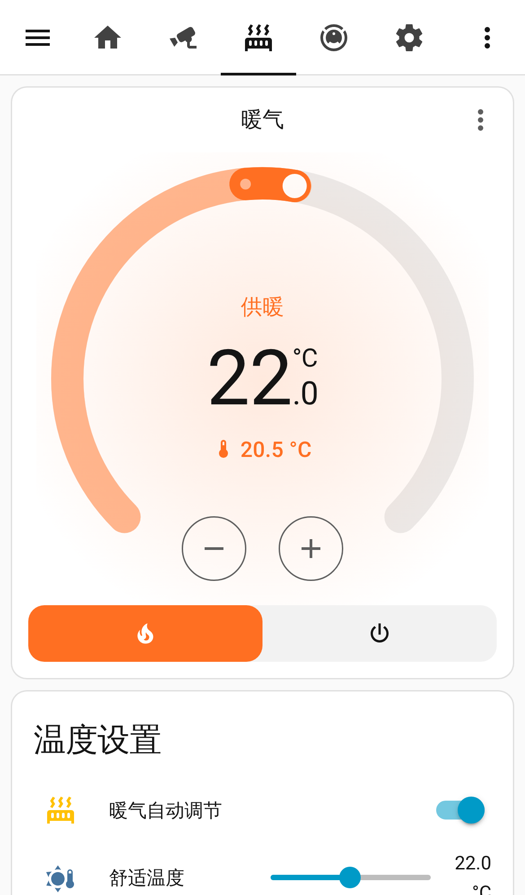

# 🏠 我的智能家居控制系统

基于 [Home Assistant](https://www.home-assistant.io/)（免费、开源、本地运行），统一控制 **扫地机器人、监控摄像头、暖气**，在手机上随时随地查看和操作。

| 暖气 | 扫地机器人 |
|---|---|
|  |  |

## 功能一览

**手机仪表盘（5 个页面）**
- **首页**：家庭模式、暖气温度、扫地机状态、书桌摄像头画面、快捷按钮
- **监控**：实时画面、移动侦测记录、报警开关
- **暖气**：温控旋钮、舒适/睡眠/节能温度设置、24 小时温度曲线
- **扫地机**：开始 / 暂停 / 停止 / 回充 / 寻找、上次清扫时间、清扫记录
- **设置**：起床 / 睡觉时间、各项自动化总开关

**自动化（不用手动操作）**

| 场景 | 自动执行 |
|---|---|
| 全家都出门了 | 切换到「离家」→ 暖气降到节能温度 → 扫地机开始清扫 → 监控开始报警 |
| 有人回家 | 切换到「在家」→ 暖气恢复舒适温度 → 正在清扫的扫地机自动回充 |
| 回家路上（距家 5 公里内） | 暖气提前预热，并推送通知 |
| 到睡觉时间 | 「睡眠」模式 → 暖气调到睡眠温度，监控开启夜间报警 |
| 离家 / 睡眠时摄像头检测到移动 | 截图并推送到手机，点开可看实时画面 |
| 扫地机清扫完成 / 被卡住 | 推送手机通知 |
| 室温低于 12°C | 推送防冻提醒 |
| 每天凌晨 | 自动清理 7 天前的监控截图 |

> 以上逻辑已在 Home Assistant 2026.2 上实际运行测试通过。

---

## 安装步骤

### 第 1 步：MacBook Air 当主机
MacBook Air 2024 用的是苹果 M 系列芯片，**不能直接装 Home Assistant 系统**。所以用免费的 **UTM** 虚拟机，在 macOS 里跑一个 Home Assistant。好处是 **Mac 不用清空**，平时照样能用。

> 💡 先想一下：2024 款 MacBook Air 还值不少钱。如果它以后基本不用，卖掉再买一台 **Home Assistant Green**（约 100 美元，插电就用、功耗只有几瓦）可能更划算。下面是用 Mac 的方法。

### 第 2 步：在 Mac 上安装 Home Assistant

**① 下载两样东西**
- [UTM](https://mac.getutm.app/)（免费虚拟机软件）
- Home Assistant 系统镜像：打开 [HA OS 发布页](https://github.com/home-assistant/operating-system/releases)，在最新版本里下载 **`haos_generic-aarch64-<版本号>.qcow2.xz`**，下载后**双击解压**，得到 `.qcow2` 文件

**② 在 UTM 里新建虚拟机**
1. 打开 UTM → **新建** → **虚拟化** → **Linux**
2. 「启动映像」**不选**，直接下一步
3. 内存 **4096 MB**，CPU **2 核**
4. 存储随便填，下一步，共享文件夹跳过。名称填 `Home Assistant`，**先不要启动**
5. 在虚拟机上右键 → **编辑**：
   - **网络** → 网络模式选 **桥接（高级）**，界面选 **en0**（Wi-Fi）⭐ 这一步决定 HA 能不能找到家里的设备
   - **驱动器**：删掉刚才自动建的那个硬盘 → **新建 → 导入**，选第 ① 步解压出的 `.qcow2` 文件
   - 导入后点这个硬盘，**调整大小**到 **32 GB**
6. 保存，点 ▶️ 启动。等 5 到 10 分钟，屏幕上出现 `homeassistant login:` 就是装好了
7. 在手机或 Mac 浏览器打开 `http://homeassistant.local:8123`，创建账号

**③ 让 Mac 24 小时不睡觉**（不做的话，Mac 一睡眠 HA 就停了）
- **系统设置 → 电池 → 选项**：打开「使用电源适配器且显示器关闭时，防止自动进入睡眠」
- **系统设置 → 锁定屏幕**：「使用电源适配器且不活跃时关闭显示器」可以设短一点，关屏没关系，只要不睡眠就行
- ⚠️ **不要合上盖子**，MacBook 合盖就会睡眠
- **系统设置 → 通用 → 登录项**：加上 UTM；在 UTM 里把虚拟机设为自动启动
- Mac 一直插着电：打开「电池 → 优化电池充电」，或者装 [AlDente](https://apphousekitchen.com/) 把充电上限设成 80%，保护电池

**④ 把本仓库的配置放进去**
1. HA 里打开 **设置 → 加载项 → 加载项商店**，安装 **Samba share**，设置密码后启动
2. Mac 访达 → **前往 → 连接服务器** → 输入 `smb://homeassistant.local`，打开 `config` 文件夹
3. 把本仓库 `config/` 里的文件复制进去，同名文件直接覆盖
4. HA 里打开 **开发者工具 → YAML → 检查配置**，没有报错就点重启

### 第 3 步：接入你的设备

#### 🧹 Narwal Freo X Ultra 扫地机
Freo X Ultra **没有局域网接口**，只能通过云鲸的云端连接。可用的是社区集成 [Behike/narwal-integration](https://github.com/Behike/narwal-integration)，作者就是在 Freo X Ultra 上开发测试的。
1. 先装 **HACS**（HA 的社区插件商店）：按 [HACS 官方教程](https://hacs.xyz/docs/use/) 安装并重启
2. HACS → 右上角 ⋮ → **自定义存储库** → 填 `https://github.com/Behike/narwal-integration`，类别选 **Integration**
3. 在 HACS 里搜索 **Narwal**，安装后重启 HA
4. **设置 → 设备与服务 → 添加集成 → Narwal**，填云鲸 App 的**邮箱、密码**，地区选 **US**
5. 如果要求填 **Product Key**，Freo X Ultra 的是 `EHf6cRNRGT`

接入后，把实体 ID 改成 **`vacuum.narwal`**（扫地机）和 **`sensor.narwal_battery`**（电量）。你在云鲸 App 里给扫地机起名叫 "Home assistant"，所以默认 ID 可能是 `vacuum.home_assistant` 之类，记得改。

> ⚠️ **说实话，这一步可能会卡住**：
> - 这个集成还在开发中，用的人很少，云鲸更新固件或云端后可能失效
> - 有的版本（如 [quittung 的分支](https://github.com/quittung/narwal-integration)）要求填 32 位的「Device Name」，这个只能从 App 的网络数据里抓，普通用户很难拿到。如果遇到这一步，把界面截图发给我
> - 本地集成（Narwal Local、Narwal Flow 等）**不支持 Freo X Ultra**，不用试
>
> 就算扫地机暂时接不上，暖气和监控也照常工作，手机页面里扫地机那一块会显示「不可用」。

#### 🔥 Google Nest 温控器
用 HA 官方的 **Google Nest** 集成。Google 要求先完成一次性设置，大约 20 分钟：
1. 在 [Google Device Access](https://console.nest.google.com/device-access) 注册，需要一次性支付 **5 美元**
2. 在 Google Cloud 创建 OAuth 凭据
3. 在 HA 里添加 **Google Nest** 集成，跟着向导走（每一步都有说明）

详细图文步骤见 [官方文档](https://www.home-assistant.io/integrations/nest/)。

接入后，把温控器的实体 ID 改成 **`climate.heating`**（方法见第 4 步）。

> 夏天 Nest 处于制冷或自动冷暖模式时，自动调温会自己跳过，不会误开暖气。

#### 📹 CareCamPro 摄像头
CareCamPro 是白牌摄像头，没有专门的集成，但大多支持 **ONVIF / RTSP** 标准协议：
1. 在 CareCamPro App 里查看摄像头的 **IP 地址**，在路由器里给它固定 IP
2. HA 添加 **ONVIF** 集成，填：
   - 主机：摄像头 IP
   - 端口：先试 **6688**，不行再试 **8899**、**80**
   - 用户名：`admin`
   - 密码：你在 App 里设置的设备密码。网上流传的出厂默认密码是 `admin123456`
3. 成功后会生成摄像头画面；如果摄像头支持，还会生成**移动侦测**传感器
4. ONVIF 连不上的话，改用 **Generic Camera** 集成，填 RTSP 地址试试（不同批次路径不一样）：
   - `rtsp://admin:密码@IP:554/onvif1`
   - `rtsp://admin:密码@IP:8554/profile0`

   可以先用电脑上的 VLC「打开网络串流」验证哪个能播放

> 🔒 **安全提醒**：这类便宜摄像头默认密码是公开的，一定要改掉。

> 以上端口和路径来自网友经验，不同批次的摄像头可能不同。卡住了把报错发给我。

#### 🔌 Kasa EP10 智能插座
1. 先用 **Kasa App** 把插座连上家里 Wi-Fi。注意它**只支持 2.4GHz**，如果 Spectrum 路由器 2.4G 和 5G 用的是同一个名字，一般也能连上
2. HA 通常会在 **设置 → 设备与服务 → 已发现** 里自动找到 **TP-Link Smart Home**，点「配置」即可。较新的固件会要求填 Kasa / TP-Link 账号密码
3. 把两个插座的实体 ID 改成 `switch.plug_1`、`switch.plug_2`

> EP10 没有电量统计功能。想看耗电量，可以选带电量统计的型号，比如 Kasa EP25。

### 第 4 步：统一实体 ID ⭐
进入 **设置 → 设备与服务 → 实体**，点开对应设备 → ⚙️ → 修改「实体 ID」：

| 改成这个 ID | 是什么 |
|---|---|
| `vacuum.narwal` | Narwal 扫地机 |
| `sensor.narwal_battery` | 扫地机电量 |
| `climate.heating` | Nest 温控器 |
| `camera.desk` | 书桌摄像头的画面 |
| `binary_sensor.desk_motion` | 书桌摄像头的移动侦测 |
| `switch.plug_1` / `switch.plug_2` | 两个 Kasa 插座 |

> 以后加摄像头？告诉我，我帮你改 `cameras.yaml` 和手机页面。
> 摄像头没有移动侦测传感器的话，实时画面照常能看，只是没有「有人移动」推送。

### 第 4.5 步：华为平板 → 墙上中控屏 📱
本仓库自带一个横屏中控页面，一屏就能看到家庭模式、天气、暖气、摄像头、扫地机和插座：


华为平板**没有 Google 服务**，应用市场里也搜不到 Home Assistant。先看一下系统版本：**设置 → 关于平板 → 软件版本**。

**情况 1：HarmonyOS 2 / 3 / 4（能装安卓 APK）**
1. 用平板浏览器打开 [F-Droid 上的 Home Assistant 精简版](https://f-droid.org/packages/io.homeassistant.companion.android.minimal/)，下载 APK 并安装（安装时允许「未知来源」）。这个版本不需要 Google 服务
2. 打开 App，地址填 `http://homeassistant.local:8123`。连不上的话，填主机的 IP，比如 `http://192.168.1.50:8123`
3. 登录后，在侧边栏打开 **「中控屏」**
4. 想要更像墙上的面板：改装 **[Fully Kiosk Browser](https://www.fully-kiosk.com/)**（官网下载 APK），主页设成 `http://<HA地址>:8123/home-tablet`。它能全屏、锁定页面，还能用平板摄像头感应有人走近时自动亮屏

**情况 2：HarmonyOS NEXT / 5 及以上（纯血鸿蒙，不能装安卓 App）**
1. 用华为浏览器打开 `http://<HA地址>:8123/home-tablet`，登录时勾选「保持登录」
2. 浏览器菜单 → **添加到桌面**，以后从桌面图标打开，就像一个 App

**两种情况都要设置：**
- **设置 → 显示和亮度 → 休眠 → 永不**
- 平板一直插电，并在 **设置 → 电池 → 更多电池设置** 里打开「**智能充电模式**」，保护电池
- 用便宜的墙面平板支架或磁吸支架固定在门口或客厅

> 精简版 App 不支持定位和推送通知。所以**离家、回家判断和报警推送要靠你的手机**，平板只负责显示和控制。

### 第 5 步：安装手机 App
1. 在 App Store / Google Play 搜索 **Home Assistant** 并安装
2. 登录你的 Home Assistant，**允许定位和通知权限**
3. 到 **设置 → 设备与服务 → Mobile App** 查看你手机的名字，然后把通知服务改成 `notify.mobile_app_phone`：
   最简单的办法是在 App 里 **设置 → 伴侣应用 → 设备名称** 改成 `phone`
4. 在 App 侧边栏打开 **「我的家」** 仪表盘，可设为默认首页

### 第 6 步：开启「回家预热」（可选）
**设置 → 设备与服务 → 添加集成 → Proximity（邻近）**，区域选「家」，跟踪你的手机，名字填 `home`。会生成 `sensor.home_nearest_distance` 等实体，预热自动化会自动生效。

### 第 7 步：在外面也能用
- **最简单**：订阅 [Nabu Casa](https://www.nabucasa.com/)（官方远程访问，同时支持官方开发）
- **免费**：用 [Tailscale](https://tailscale.com/) 组建虚拟局域网，手机装 Tailscale 即可访问
- 不建议直接在路由器上做端口映射暴露 8123

### 第 8 步：重启并检查
**开发者工具 → YAML → 检查配置**，没有报错后点 **重启**。

---

## 目录结构

```
config/
├── configuration.yaml        主配置
├── packages/                 按设备拆分的功能
│   ├── home_mode.yaml        家庭模式（在家/离家/睡眠/度假）
│   ├── vacuum.yaml           扫地机器人
│   ├── heating.yaml          暖气
│   ├── cameras.yaml          监控摄像头
│   └── plugs.yaml            智能插座
├── dashboards/mobile.yaml    手机仪表盘
├── dashboards/tablet.yaml    平板中控屏
└── secrets.yaml.example      密码模板（复制成 secrets.yaml）
docker-compose.yml            Docker 部署（备用，Linux / NAS 用）
```

## 常见调整

- **修改温度**：直接在手机「暖气」页拖动滑块即可。重启后会恢复为 `heating.yaml` 里的 `initial` 值，想永久修改请改那里。
- **修改起床 / 睡觉时间**：手机「设置」页。
- **不想离家自动扫地 / 不想收到报警**：手机「设置」页关掉对应开关。
- **度假模式**：在首页手动选「度假」，暖气保持 12°C 防冻，监控全天报警，回家后自动恢复。

---

## 🏡 全屋智能升级路线

已有：扫地机 ✅ 暖气 ✅ 摄像头 ✅ 智能插座 ✅ 主机电脑 ✅ 中控平板 ✅

按「性价比 + 对生活改善」从高到低排。以下都**适合租房**：插上就用，不用改电线。

| 优先级 | 买什么 | 能实现什么 |
|---|---|---|
| ✅ 已有 | MacBook Air 当主机，华为平板当中控屏 | 不用另买 |
| ② 强烈推荐 | **网络版 Zigbee 网关**，比如 SMLIGHT SLZB-06（插网线，放在家中间位置） | 接入下面这些便宜、省电、不占 Wi-Fi 的传感器。你的 HA 跑在 Mac 虚拟机里，USB 网关要做 USB 直通，容易出问题，网络版最省心 |
| ③ | **门窗传感器**（Aqara、Third Reality 等 Zigbee 款） | 开门推送到手机；开窗时暖气自动暂停，省暖气费 |
| ④ | **人体传感器** | 晚上起夜自动开灯；没人自动关灯 |
| ⑤ | **温湿度传感器**（每个房间一个） | 卧室温度偏低时，暖气按卧室温度调节；冬天太干燥时提醒你 |
| ⑥ | **智能灯泡**（Kasa / Tapo / Philips Hue） | 回家自动开灯、睡觉一键关全屋、早上渐亮叫醒 |
| ⑦ | **漏水传感器**（放在洗衣机、水槽下） | 漏水立刻报警，避免泡坏地板被房东扣押金 |
| ⑧ 可选 | 智能门锁 / 门铃 | 远程开门、访客提醒（租房要先问房东） |

**买传感器时认准 Zigbee 协议**：便宜、电池能用 1 到 2 年，而且不依赖厂家 App 和云端。
避开只能用自家 App、Home Assistant 接不了的小众品牌。

买了新设备告诉我型号，我帮你接进系统、加到手机页面、写好联动。
